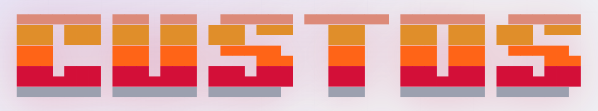
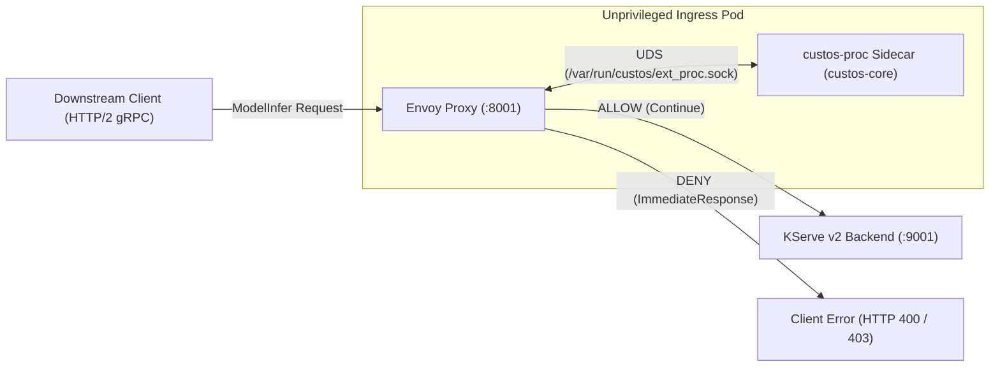

<!-- Improved compatibility of back to top link: See: https://github.com/othneildrew/Best-README-Template/pull/73 -->
<a id="readme-top"></a>

<!-- PROJECT SHIELDS -->
[![Contributors][contributors-shield]][contributors-url]
[![Forks][forks-shield]][forks-url]
[![Stargazers][stars-shield]][stars-url]
[![Issues][issues-shield]][issues-url]
[![Apache-2.0 License][license-shield]][license-url]
[![Unsafe Forbidden][unsafe-shield]][repo-url]
[![Benchmark Suite][bench-shield]][bench-url]


<!-- PROJECT LOGO -->
<br />
<div align="center">
  <a href="https://github.com/val-27/Custos-Gateway">
    
  </a>

  <h3 align="center">Custos-Gateway</h3>

  <p align="center">
    Layer 7 admission control for KServe v2 gRPC traffic with Rust and Envoy <code>ext_proc</code>.
    <br />
    <a href="https://val-27.github.io/custos-web/"><strong>View Full Documentation &amp; Benchmarks (Custos-Web) »</strong></a>
    <br />
    <br />
    <a href="https://github.com/val-27/Custos-Bench">Benchmark Suite (Custos-Bench)</a>
    &middot;
    <a href="./deployments/k8s-topology1-gateway-sidecar/README.md">Kubernetes Deployment</a>
    &middot;
    <a href="https://github.com/val-27/Custos-Gateway/issues/new?labels=bug">Report Bug</a>
    &middot;
    <a href="https://github.com/val-27/Custos-Gateway/issues/new?labels=enhancement">Request Feature</a>
  </p>
</div>


<!-- TABLE OF CONTENTS -->
<details>
  <summary>Table of Contents</summary>
  <ol>
    <li>
      <a href="#about-the-project">About The Project</a>
      <ul>
        <li><a href="#data-path-topology">Data Path Topology</a></li>
        <li><a href="#repository-structure">Repository Structure</a></li>
        <li><a href="#built-with">Built With</a></li>
      </ul>
    </li>
    <li>
      <a href="#getting-started">Getting Started</a>
      <ul>
        <li><a href="#prerequisites">Prerequisites</a></li>
        <li><a href="#installation">Installation</a></li>
      </ul>
    </li>
    <li>
      <a href="#usage">Usage</a>
      <ul>
        <li><a href="#start-local-deployments">Start Local Deployments</a></li>
        <li><a href="#start-kubernetes-deployments">Start Kubernetes Deployments</a></li>
        <li><a href="#cli-parameters">CLI Parameters</a></li>
      </ul>
    </li>
    <li><a href="#roadmap">Roadmap</a></li>
    <li><a href="#contributing">Contributing</a></li>
    <li><a href="#license">License</a></li>
    <li><a href="#citation">Citation</a></li>
    <li><a href="#contact">Contact</a></li>
    <li><a href="#acknowledgments">Acknowledgments</a></li>
  </ol>
</details>


<!-- ABOUT THE PROJECT -->
## About The Project

`Custos-Gateway` inspects KServe v2 gRPC inference requests before they reach the inference server.
Envoy Proxy receives client HTTP/2 traffic and sends each request over a Unix Domain Socket (UDS) to `custos-proc`.
`custos-proc` uses `custos-core` to check the binary Protocol Buffers (Protobuf) wire format with zero heap allocations.
If a request is valid, `custos-proc` tells Envoy to forward the request to the backend.
If a request violates a wire rule, `custos-proc` tells Envoy to reject the request immediately.

For full architecture notes, security rules, and benchmark data, see [Custos-Web](https://val-27.github.io/custos-web/).

### Data Path Topology



### Repository Structure

```text
Custos-Gateway/
├── Cargo.toml                         # Rust 2024 workspace
├── Dockerfile                         # Multi-stage container build (UID/GID 10001)
├── images/
│   └── CUSTOS.png                     # Project banner
├── proto/envoy/service/ext_proc/v3/   # Envoy ExternalProcessor v3 proto files
├── crates/
│   ├── custos-core/                   # Zero-copy Protobuf wire scanner (#![no_std])
│   │   └── src/
│   │       ├── lib.rs                 # Public API and unit tests
│   │       ├── scanner.rs             # TLV state machine and KServe v2 checks
│   │       ├── varint.rs              # 10-byte Base-128 varint decoder
│   │       └── error.rs               # ParseError definitions
│   └── custos-proc/                   # Envoy ext_proc daemon over UDS
│       └── src/
│           ├── main.rs                # CLI, UDS setup, and integration tests
│           ├── service.rs             # ExternalProcessor stream handler
│           └── triton_sim.rs          # KServe v2 test backend
└── deployments/
    ├── bare-metal/                    # Local Envoy and sidecar configurations
    └── k8s-topology1-gateway-sidecar/ # Kubernetes manifests
```

<p align="right">(<a href="#readme-top">back to top</a>)</p>


### Built With

* [![Rust][Rust-badge]][Rust-url]
* [![Envoy][Envoy-badge]][Envoy-url]
* [![gRPC][gRPC-badge]][gRPC-url]
* [![Protobuf][Protobuf-badge]][Protobuf-url]
* [![NVIDIA Triton][Triton-badge]][Triton-url]
* [![Kubernetes][Kubernetes-badge]][Kubernetes-url]
* [![Docker][Docker-badge]][Docker-url]

<p align="right">(<a href="#readme-top">back to top</a>)</p>


<!-- GETTING STARTED -->
## Getting Started

Use these steps to build and test `Custos-Gateway`.

### Prerequisites

* **Rust Toolchain** (Rust 1.85 or later, Edition 2024):
  ```sh
  curl --proto '=https' --tlsv1.2 -sSf https://sh.rustup.rs | sh
  ```
* **Envoy Proxy** (v1.28 or later with `ext_proc` support) for local runs.
* **Docker and `kubectl`** for container and Kubernetes runs.

### Installation

1. Clone the repository:
   ```sh
   git clone https://github.com/val-27/Custos-Gateway.git
   cd Custos-Gateway
   ```
2. Run all unit and integration tests:
   ```sh
   cargo test --workspace
   ```
3. Build the release binary:
   ```sh
   cargo build --release -p custos-proc
   ```
4. Build the container image (optional):
   ```sh
   docker build -t custos-proc:latest .
   ```

<p align="right">(<a href="#readme-top">back to top</a>)</p>


<!-- USAGE EXAMPLES -->
## Usage

### Start Local Deployments

Run the local helper script from the repository root:

```sh
# Start Envoy with the custos-proc sidecar
./deployments/bare-metal/run-local.sh custos

# Start Envoy without the sidecar (baseline)
./deployments/bare-metal/run-local.sh baseline
```

### Start Kubernetes Deployments

Apply the Kubernetes manifests in order:

```sh
kubectl apply -f deployments/k8s-topology1-gateway-sidecar/deployment-triton-pod.yaml
kubectl apply -f deployments/k8s-topology1-gateway-sidecar/deployment-envoy-baseline-pod.yaml
kubectl apply -f deployments/k8s-topology1-gateway-sidecar/configmap-envoy.yaml
kubectl apply -f deployments/k8s-topology1-gateway-sidecar/deployment-gateway-pod.yaml
```

### CLI Parameters

| Flag | Environment Variable | Default | Description |
| :--- | :--- | :--- | :--- |
| `--socket-path` | `CUSTOS_SOCKET_PATH` | `/var/run/custos/ext_proc.sock` | Set the UDS file path (`0660` permissions). |
| `--max-nesting-depth` | `CUSTOS_MAX_NESTING_DEPTH` | `16` | Set the maximum Protobuf submessage depth (`1..=16`). |
| `--max-tensor-elements` | `CUSTOS_MAX_TENSOR_ELEMENTS` | `16777216` | Set the maximum element count per tensor. |
| `--max-tags-scanned` | `CUSTOS_MAX_TAGS_SCANNED` | `1024` | Set the maximum number of scanned tags per message. |
| `--enforce-payload-parity` | `CUSTOS_ENFORCE_PAYLOAD_PARITY` | `true` | Require tensor byte size to match declared shape. |
| `--max-message-size-mb` | `CUSTOS_MAX_MESSAGE_SIZE_MB` | `32` | Set the maximum gRPC message size in MiB. |
| `--log-format` | `CUSTOS_LOG_FORMAT` | `json` | Set the log format (`json`, `compact`, `pretty`). |
| `--log-level` | `CUSTOS_LOG_LEVEL` | `info` | Set the log level when `RUST_LOG` is not set. |
| `--log-admitted` | `CUSTOS_LOG_ADMITTED` | `true` | Write an `INFO` log for each allowed request. |
| `--stats-interval-secs` | `CUSTOS_STATS_INTERVAL_SECS` | `60` | Set the metrics log interval in seconds (`0` disables). |

<p align="right">(<a href="#readme-top">back to top</a>)</p>


<!-- ROADMAP -->
## Roadmap

- [x] Zero-copy `#![no_std]` Protobuf wire scanner (`custos-core`) with `#![forbid(unsafe_code)]`
- [x] 10-byte varint limit and fixed-stack depth tracker (`MAX_DEPTH = 16`)
- [x] KServe v2 `ModelInferRequest` checks with $O(1)$ tensor buffer skips
- [x] Per-input tensor shape and buffer size matching
- [x] KServe v2 RPC path allowlist and `shared_memory_*` parameter rejection
- [x] Bare-metal and Kubernetes Native Sidecar deployments
- [ ] Prometheus metrics endpoint
- [ ] Per-model tensor shape policy files
- [ ] Support for additional gRPC inference protocols

See the [open issues](https://github.com/val-27/Custos-Gateway/issues) for all proposed features and known issues.

<p align="right">(<a href="#readme-top">back to top</a>)</p>


<!-- CONTRIBUTING -->
## Contributing

Use these steps to submit a change:

1. Fork the repository.
2. Create a feature branch (`git checkout -b feature/NewFeature`).
3. Commit your changes (`git commit -m 'Add NewFeature'`).
4. Push the branch (`git push origin feature/NewFeature`).
5. Open a pull request.

### Top contributors:

<a href="https://github.com/val-27/Custos-Gateway/graphs/contributors">
  
</a>

<p align="right">(<a href="#readme-top">back to top</a>)</p>


<!-- LICENSE -->
## License

Distributed under the Apache License, Version 2.0. See [`LICENSE`](./LICENSE) for details.

<p align="right">(<a href="#readme-top">back to top</a>)</p>


<!-- CITATION -->
## Citation

Use this BibTeX entry to cite `Custos-Gateway`:

```bibtex
@software{valentine2026custos,
  author       = {Valentine, JP},
  title        = {{Custos-Gateway: Layer 7 Admission Control for AI Inference Traffic Using Rust and Envoy ext\_proc}},
  year         = {2026},
  url          = {https://github.com/val-27/Custos-Gateway},
  license      = {Apache-2.0}
}
```

<p align="right">(<a href="#readme-top">back to top</a>)</p>


<!-- CONTACT -->
## Contact

JP Valentine - [@val-27](https://github.com/val-27)

* **Documentation & Benchmarks (Custos-Web):** [https://val-27.github.io/custos-web/](https://val-27.github.io/custos-web/)
* **Gateway Repository:** [https://github.com/val-27/Custos-Gateway](https://github.com/val-27/Custos-Gateway)
* **Benchmark Suite Repository:** [https://github.com/val-27/Custos-Bench](https://github.com/val-27/Custos-Bench)

<p align="right">(<a href="#readme-top">back to top</a>)</p>


<!-- ACKNOWLEDGMENTS -->
## Acknowledgments

* [Custos-Bench](https://github.com/val-27/Custos-Bench)
* [Envoy Proxy External Processing (`ext_proc`)](https://www.envoyproxy.io/docs/envoy/latest/configuration/http/http_filters/ext_proc_filter)
* [KServe v2 Inference Protocol Specification](https://kserve.github.io/website/latest/modelserving/data_plane/v2_protocol/)
* [NVIDIA Triton Inference Server](https://github.com/triton-inference-server/server)
* [Tokio & Tonic](https://github.com/hyperium/tonic)
* [Best-README-Template](https://github.com/othneildrew/Best-README-Template)

<p align="right">(<a href="#readme-top">back to top</a>)</p>


<!-- MARKDOWN LINKS & IMAGES -->
<!-- https://www.markdownguide.org/basic-syntax/#reference-style-links -->
[repo-url]: https://github.com/val-27/Custos-Gateway
[contributors-shield]: https://img.shields.io/github/contributors/val-27/Custos-Gateway.svg?style=for-the-badge
[contributors-url]: https://github.com/val-27/Custos-Gateway/graphs/contributors
[forks-shield]: https://img.shields.io/github/forks/val-27/Custos-Gateway.svg?style=for-the-badge
[forks-url]: https://github.com/val-27/Custos-Gateway/network/members
[stars-shield]: https://img.shields.io/github/stars/val-27/Custos-Gateway.svg?style=for-the-badge
[stars-url]: https://github.com/val-27/Custos-Gateway/stargazers
[issues-shield]: https://img.shields.io/github/issues/val-27/Custos-Gateway.svg?style=for-the-badge
[issues-url]: https://github.com/val-27/Custos-Gateway/issues
[license-shield]: https://img.shields.io/github/license/val-27/Custos-Gateway.svg?style=for-the-badge
[license-url]: https://github.com/val-27/Custos-Gateway/blob/main/LICENSE
[unsafe-shield]: https://img.shields.io/badge/unsafe-forbid-success.svg?style=for-the-badge&logo=rust
[bench-shield]: https://img.shields.io/badge/benchmark-Custos--Bench-orange.svg?style=for-the-badge
[bench-url]: https://github.com/val-27/Custos-Bench
[Rust-badge]: https://img.shields.io/badge/Rust-000000?style=for-the-badge&logo=rust&logoColor=white
[Rust-url]: https://www.rust-lang.org/
[Envoy-badge]: https://img.shields.io/badge/Envoy_Proxy-AC6199?style=for-the-badge&logo=envoyproxy&logoColor=white
[Envoy-url]: https://www.envoyproxy.io/
[gRPC-badge]: https://img.shields.io/badge/gRPC-244C5A?style=for-the-badge&logo=grpc&logoColor=white
[gRPC-url]: https://grpc.io/
[Protobuf-badge]: https://img.shields.io/badge/Protobuf-4285F4?style=for-the-badge&logo=google&logoColor=white
[Protobuf-url]: https://protobuf.dev/
[Triton-badge]: https://img.shields.io/badge/NVIDIA_Triton-76B900?style=for-the-badge&logo=nvidia&logoColor=white
[Triton-url]: https://developer.nvidia.com/triton-inference-server
[Kubernetes-badge]: https://img.shields.io/badge/Kubernetes-326CE5?style=for-the-badge&logo=kubernetes&logoColor=white
[Kubernetes-url]: https://kubernetes.io/
[Docker-badge]: https://img.shields.io/badge/Docker-2496ED?style=for-the-badge&logo=docker&logoColor=white
[Docker-url]: https://www.docker.com/
