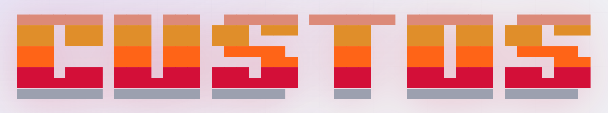

<!-- Improved compatibility of back to top link: See: https://github.com/othneildrew/Best-README-Template/pull/73 -->
<a id="readme-top"></a>

<!-- PROJECT SHIELDS -->
[![Contributors][contributors-shield]][contributors-url]
[![Forks][forks-shield]][forks-url]
[![Stargazers][stars-shield]][stars-url]
[![Issues][issues-shield]][issues-url]
[![Apache-2.0 License][license-shield]][license-url]
[![Unsafe Forbidden][unsafe-shield]][repo-url]
[![Benchmark Suite][bench-shield]][bench-url]


<!-- PROJECT LOGO -->
<br />
<div align="center">
  <a href="https://github.com/val-27/Custos-Gateway">
    
  </a>

  <h3 align="center">Custos-Gateway</h3>

  <p align="center">
    <em><strong>Custōs</strong> — Latin (<code>KUSS-tahss</code> or <code>KUSS-tohs</code>), meaning a <strong>keeper, guardian, protector, or custodian</strong>.</em>
    <br />
    <br />
    High-Performance, Zero-Copy Layer 7 Admission Control for AI Inference Traffic Using Rust and Envoy <code>ext_proc</code>
    <br />
    <a href="#about-the-project"><strong>Explore the docs »</strong></a>
    <br />
    <br />
    <a href="https://github.com/val-27/Custos-Bench">Benchmark Suite (Custos-Bench)</a>
    &middot;
    <a href="./deployments/k8s-topology1-gateway-sidecar/README.md">Kubernetes Deployment</a>
    &middot;
    <a href="https://github.com/val-27/Custos-Gateway/issues/new?labels=bug">Report Bug</a>
    &middot;
    <a href="https://github.com/val-27/Custos-Gateway/issues/new?labels=enhancement">Request Feature</a>
  </p>
</div>


<!-- TABLE OF CONTENTS -->
<details>
  <summary>Table of Contents</summary>
  <ol>
    <li>
      <a href="#about-the-project">About The Project</a>
      <ul>
        <li><a href="#problem-statement--architectural-rationale">Problem Statement & Architectural Rationale</a></li>
        <li><a href="#core-technical-invariants-custos-core">Core Technical Invariants (<code>custos-core</code>)</a></li>
        <li><a href="#scientific-evaluation--security-summary">Scientific Evaluation & Security Summary</a></li>
        <li><a href="#repository-structure">Repository Structure</a></li>
        <li><a href="#built-with">Built With</a></li>
      </ul>
    </li>
    <li>
      <a href="#getting-started">Getting Started</a>
      <ul>
        <li><a href="#prerequisites">Prerequisites</a></li>
        <li><a href="#installation">Installation</a></li>
      </ul>
    </li>
    <li>
      <a href="#usage">Usage</a>
      <ul>
        <li><a href="#deployment--evaluation-architectures">Deployment & Evaluation Architectures</a></li>
        <li><a href="#custos-proc-cli-reference"><code>custos-proc</code> CLI Reference</a></li>
      </ul>
    </li>
    <li><a href="#roadmap">Roadmap</a></li>
    <li><a href="#contributing">Contributing</a></li>
    <li><a href="#license">License</a></li>
    <li><a href="#citation">Citation</a></li>
    <li><a href="#contact">Contact</a></li>
    <li><a href="#acknowledgments">Acknowledgments</a></li>
  </ol>
</details>


<!-- ABOUT THE PROJECT -->
## About The Project


```text
                     ┌──────────────────────────────────────────────────────────┐
                     │                Unprivileged Ingress Plane                │
                     │                                                          │
Downstream Client ───┼──► Envoy Proxy (:8001) ═══[ UDS: ext_proc.sock ]═══► custos-proc
 (TLS 1.3 / HTTP/2)  │     • Terminates TLS 1.3          (0660)             (custos-core)
                     │     • Reassembles TCP                                • Zero-alloc TLV scan
                     │     • Demultiplexes HTTP/2                           • ≤10B varint bound
                     └───────────────┬──────────────────────────────────────────┬┘
                                     │ ALLOW (Continue)                         │ DENY (ImmediateResponse)
                                     ▼                                          ▼
                          NVIDIA Triton Server (:9001)               HTTP 400 / gRPC INVALID_ARGUMENT (3)
```

### Problem Statement & Architectural Rationale

Modern AI inference runtimes—such as **NVIDIA Triton Inference Server**—rely on high-throughput gRPC streams transporting binary Protocol Buffers (Protobuf) tensor payloads (`KServe v2` / `inference.GRPCInferenceService/ModelInfer`). Because model runtimes execute tight compute-bound operations on specialized GPU and CPU hardware, they assume well-formed wire inputs and are acutely vulnerable to resource-exhausting or structurally malformed payloads:

* **Protobuf Nesting Bombs:** Deeply nested `Wire Type 2` length-delimited submessages that exhaust C++ recursive parser call stacks.
* **Tensor Shape Overflows:** Anomalous dimension arrays (negative dimensions, 64-bit integer wraparounds, or multi-gigabyte dimension products) that trigger unhandled out-of-memory (OOM) heap allocations before tensor buffer bounds are checked.
* **Malformed Varints:** Unterminated Base-128 varint sequences (`11+` continuation bytes with `MSB = 1` or 10th-byte 64-bit overflows) that stall wire parsers.

#### Why Layer 7 `ext_proc` Instead of Layer 2/3 `AF_XDP` / `eBPF`?
Custos pivoted from a kernel-bypass `AF_XDP` packet filter to an **unprivileged, zero-copy Layer 7 admission control daemon** written in Rust due to three physical systems boundaries verified during early prototyping:
1. **Cryptographic Blindness (TLS 1.3 / mTLS):** Ephemeral per-connection keys render NIC-level packet rings opaque ciphertext; the Linux eBPF verifier prohibits the unbounded loops and dynamic allocations required to terminate TLS in-kernel.
2. **Multi-Frame TCP Segmentation & HTTP/2 Multiplexing:** Inference tensors (`600 KB` to `9.6+ MB`) span hundreds of MTU frames that can arrive out of order and are multiplexed across stateful HTTP/2 streams using HPACK header compression. Inspecting application payloads at the packet ring requires re-implementing a full user-space TCP reassembly and HTTP/2 state machine.
3. **Privilege & Blast-Radius Constraints:** `AF_XDP` requires `CAP_NET_ADMIN`, `CAP_BPF`, and host networking on GPU nodes, introducing security exposure and colliding with cluster CNIs (such as Cilium).

### Core Technical Invariants (`custos-core`)

`custos-core` is compiled with `#![no_std]` and `#![forbid(unsafe_code)]`. It validates contiguous byte slices (`&[u8]`) in a **single pass with zero heap allocations**:

1. **gRPC Frame Header Verification:**
   Validates that the leading byte has compression disabled (`0x00`) and that bytes `1..5` (big-endian `u32` declared length) match `slice.len() - 5`.
2. **Bounded 10-Byte Varint Decoding (`varint.rs`):**
   Unrolls Base-128 varint decoding up to a strict 10-byte ceiling. If byte index `9` (the 10th byte) has any bit above `0x01` set (which would overflow `u64::MAX`) or still carries a continuation bit (`0x80`), `ParseError::MalformedVarint` is raised immediately.
3. **Iterative Stack-Allocated Nesting Tracker (`scanner.rs`):**
   Tracks `Wire Type 2` submessage scopes using a fixed stack array `[ScopeFrame; MAX_DEPTH]` (`MAX_DEPTH = 16`). Any submessage exceeding depth `16` is rejected with `ParseError::NestingLimitExceeded(17)` without recursive function calls.
4. **KServe v2 Context-Aware Schema Walker & $O(1)$ Bulk Skipping:**
   Follows the KServe v2 `inference.ModelInferRequest` wire specification:
   - **Root Fields `1` (`model_name`), `2` (`model_version`), `3` (`id`), and `7` (`raw_input_contents`):** Skipped in **$O(1)$ time** by advancing the slice cursor past their length-delimited boundaries. Multi-megabyte float32 tensor buffers in Field 7 are never parsed as Protobuf tags, preventing both latency linear scans and false positives.
   - **Root Field `5` (`inputs` -> `InferInputTensor`):** Pushes an `MsgContext::InputTensor` frame onto the scope stack.
   - **`InferInputTensor` Field `3` (`shape`):** Supports both **packed repeated `int64`** (`Wire Type 2`, tag `0x1A`) and **unpacked repeated `int64`** (`Wire Type 0`, tag `0x18`). Each dimension is validated (`dim > 0`, rejecting negative dimensions with `ParseError::NegativeDimension`) and multiplied into a running product via `i64::checked_mul` (catching 64-bit integer wraparounds with `ParseError::ShapeOverflow`). If the product exceeds `DEFAULT_MAX_TENSOR_ELEMENTS` (`16,777,216` elements = `64 MiB` for `FP32`), `ParseError::BufferCeilingExceeded` is returned immediately.
5. **Shape-to-Payload Buffer Parity Verification (`CVE-2025-23334`-Class OOB Read Protection):**
   Maps `InferInputTensor` Field `2` (`datatype`: `FP32`, `FP64`, `INT64`, `FP16`, `BF16`, `INT32`, `INT8`, `UINT8`, `BOOL`, etc.) to its exact element byte width and verifies at the end of the message that $\sum (\prod \text{dim}_i \times \text{sizeof}(\text{datatype}))$ equals `len(raw_input_contents)`, rejecting buffer under-reads and over-reads with `ParseError::PayloadSizeMismatch`. For variable-length `BYTES` tensors (where each element carries a 4-byte length prefix in `raw_input_contents`), `custos-core` tracks `has_bytes_tensor` and enforces the $4 \times \prod \text{dim}_i$ lower bound without false positives on single- or multi-tensor requests.
6. **Shallow AST / Unknown-Field Flood Ceiling (`CVE-2022-1941` / `CVE-2021-22569`-Class):**
   Bounds the total number of Protobuf TLV tags scanned per message to `DEFAULT_MAX_TAGS_SCANNED` (`1,024`), preventing shallow unknown-field floods (`D = 0..1`) from triggering $10\times$–$50\times$ `UnknownFieldSet` heap amplification in downstream C++/Java/Python parsers.
7. **KServe v2 RPC Method Allowlisting & `ModelInfer` Shared-Memory Parameter Guard (`CVE-2024-0088` / `CVE-2025-23329` / `CVE-2024-53880`):**
   At the `RequestHeaders` stage in `custos-proc`, only inference and read-only health RPCs (`ModelInfer`, `ModelStreamInfer`, `ServerLive`, `ServerReady`, `ModelReady`, `ModelMetadata`, `ModelConfig`) are admitted, and non-identity `grpc-encoding` headers (`gzip`, `deflate`) are rejected. Administrative and shared-memory RPCs (`SystemSharedMemoryRegister`, `CudaSharedMemoryRegister`, `RepositoryModelLoad`, `RepositoryModelUnload`) are rejected immediately with `HTTP 403 Forbidden` and `gRPC PERMISSION_DENIED (7)` (`custos_denied:unauthorized_rpc_method`). Furthermore, because `CVE-2024-0088` can be triggered on a normal `ModelInfer` call by passing `shared_memory_region`, `shared_memory_offset`, or `shared_memory_byte_size` inside `InferInputTensor.parameters`, `InferRequestedOutputTensor.parameters`, or `ModelInferRequest.parameters`, `custos-core` inspects parameter map keys on the wire and rejects `shared_memory_*` keys with `ParseError::UnauthorizedSharedMemoryParameter`.

### Scientific Evaluation & Security Summary

`Custos-Gateway` is evaluated using [**`Custos-Bench`**](https://github.com/val-27/Custos-Bench), a coordinated-omission-free open-loop gRPC load generator and deterministic binary Protobuf exploit synthesizer:

| Threat Vector / CVE Class | Corpus Payloads (`Custos-Bench`) | `Custos-Gateway` Defense Invariant | Enforcement Stage & Action |
| :--- | :--- | :--- | :--- |
| **Unauthorized Admin RPCs & Shared-Memory Parameters** (`CVE-2024-0088`, `CVE-2025-23329`, `CVE-2024-53880`) | `SystemSharedMemoryRegister`, `cve_2024_0088_shm_params_infer` (`shared_memory_*` on `ModelInfer`) | `:path` allowlisting + `ParameterMapEntry` `shared_memory_*` key rejection | `RequestHeaders` (`403`) & `RequestBody` (`400` / `INVALID_ARGUMENT`) |
| **Recursive Submessage, `SGROUP` & Compressed Bombs** (`CVE-2024-7254`-class) | `nesting_depth_{17..500}`, `sgroup_wire_type_3_bomb`, `grpc_compressed_flag_01` | Fixed-stack depth tracker (`MAX_DEPTH = 16`), Wire Type 3/4 rejection & `flag == 0x00` enforcement | `RequestBody` $\rightarrow$ `HTTP 400` / `gRPC INVALID_ARGUMENT (3)` |
| **Tensor Shape OOM & 64-Bit Wraparound** | `shape_neg_*`, `shape_wrap_64bit_*`, `shape_oom_massive_*` | `dim > 0`, `i64::checked_mul`, `DEFAULT_MAX_TENSOR_ELEMENTS` ceiling | `RequestBody` $\rightarrow$ `HTTP 400` / `gRPC INVALID_ARGUMENT (3)` |
| **Tensor Buffer Under-Read / Over-Read** (`CVE-2025-23334`-class) | `shape_buffer_mismatch_underread` (`2.41 MB` declared vs. `64 B` payload) | Exact byte parity check between $\prod \text{dim}_i \times \text{sizeof}(\text{dtype})$ and Field 7 | `RequestBody` $\rightarrow$ `HTTP 400` / `gRPC INVALID_ARGUMENT (3)` |
| **Shallow Unknown-Field AST Flood** (`CVE-2022-1941` / `CVE-2021-22569`-class) | `unknown_field_ast_flood` (`1,500` unknown tags at `D=0`) | Bounded TLV tag counter (`DEFAULT_MAX_TAGS_SCANNED = 1,024`) | `RequestBody` $\rightarrow$ `HTTP 400` / `gRPC INVALID_ARGUMENT (3)` |
| **Malformed / Unterminated Varints** | `varint_unterminated_{11,64}`, `varint_10th_byte_overflow` | Unrolled 10-byte Base-128 decoder with 10th-byte overflow guard | `RequestBody` $\rightarrow$ `HTTP 400` / `gRPC INVALID_ARGUMENT (3)` |
| **Benign ResNet-50 (`B=1..16`) & `BYTES` Tensors** | `benign_b1` (`602 KB`) $\rightarrow$ `benign_b16` (`9.63 MB`), `benign_bytes_tensor` | $O(1)$ slice cursor jump over `raw_input_contents` & variable-width `BYTES` bounds | `RequestBody` $\rightarrow$ `ALLOW (Continue)` (`0%` False Positive Rate) |

### Repository Structure

```text
Custos-Gateway/
├── Cargo.toml                         # Rust 2024 workspace (LTO="fat", panic="abort")
├── Dockerfile                         # Multi-stage Debian Bookworm image (UID/GID 10001)
├── images/
│   └── CUSTOS.png                     # Project header banner
├── proto/envoy/service/ext_proc/v3/   # Envoy ExternalProcessor v3 protobuf definitions
├── crates/
│   ├── custos-core/                   # #![no_std], #![forbid(unsafe_code)] zero-copy TLV wire scanner
│   │   └── src/
│   │       ├── lib.rs                 # Public API & comprehensive unit test suite
│   │       ├── scanner.rs             # Single-pass TLV state machine & KServe v2 walker
│   │       ├── varint.rs              # Bounded 10-byte Base-128 varint decoder
│   │       └── error.rs               # Exhaustive ParseError taxonomy
│   └── custos-proc/                   # Async Tokio/Tonic Envoy ext_proc daemon over UDS
│       └── src/
│           ├── main.rs                # CLI, UDS lifecycle (0660), signal handling, e2e UDS test
│           └── service.rs             # ExternalProcessor stream handler & atomic ServiceMetrics
└── deployments/
    ├── bare-metal/                    # Scientific evaluation configs (Topology B & Topology C)
    └── k8s-topology1-gateway-sidecar/ # Practical production Kubernetes deployment
```

<p align="right">(<a href="#readme-top">back to top</a>)</p>


### Built With

* [![Rust][Rust-badge]][Rust-url]
* [![Envoy][Envoy-badge]][Envoy-url]
* [![gRPC][gRPC-badge]][gRPC-url]
* [![Protobuf][Protobuf-badge]][Protobuf-url]
* [![NVIDIA Triton][Triton-badge]][Triton-url]
* [![Kubernetes][Kubernetes-badge]][Kubernetes-url]
* [![Docker][Docker-badge]][Docker-url]

<p align="right">(<a href="#readme-top">back to top</a>)</p>


<!-- GETTING STARTED -->
## Getting Started

Follow these instructions to build, test, and run `Custos-Gateway` locally or inside a Kubernetes cluster.

### Prerequisites

* **Rust Toolchain** (Edition 2024 / Rust 1.85+)
  ```sh
  curl --proto '=https' --tlsv1.2 -sSf https://sh.rustup.rs | sh
  ```
* **Envoy Proxy** (v1.28+ with `ext_proc` filter support, for bare-metal runs)
* **Docker & Kubernetes (`kubectl`)** (optional, for containerized and cluster deployments)

### Installation

1. Clone the repository
   ```sh
   git clone https://github.com/val-27/Custos-Gateway.git
   cd Custos-Gateway
   ```
2. Run all unit and end-to-end Unix Domain Socket (UDS) integration tests
   ```sh
   cargo test --workspace
   ```
3. Build the optimized release binary (`fat` LTO, single codegen unit, stripped)
   ```sh
   cargo build --release -p custos-proc
   ```
4. (Optional) Build the multi-stage container image
   ```sh
   docker build -t custos-proc:latest .
   ```

<p align="right">(<a href="#readme-top">back to top</a>)</p>


<!-- USAGE EXAMPLES -->
## Usage

### Deployment & Evaluation Architectures

Located in [`deployments/k8s-topology1-gateway-sidecar/`](./deployments/k8s-topology1-gateway-sidecar/README.md) (Kubernetes) and [`deployments/bare-metal/`](./deployments/bare-metal/README.md) (Bare-Metal). Paired with [**`Custos-Bench`**](https://github.com/val-27/Custos-Bench) to evaluate three unified architectures:

* **Unprotected Control (Direct Triton):** Client directly targets NVIDIA Triton Inference Server (`:8001`).
* **Proxy Baseline (Envoy Only):** Client targets Envoy Proxy ([`envoy-baseline.yaml`](./deployments/bare-metal/envoy-baseline.yaml), `:8002`) forwarding to Triton without `ext_proc`.
* **Custos Production (Gateway + Sidecar):** Client targets Envoy Proxy ([`envoy-custos.yaml`](./deployments/bare-metal/envoy-custos.yaml) / [`k8s-topology1-gateway-sidecar`](./deployments/k8s-topology1-gateway-sidecar/README.md), `:8003` / `:8001`) co-located with the `custos-proc` Native Sidecar enforcing fail-closed `ext_proc` admission over `/var/run/custos/ext_proc.sock`.

#### A. Bare-Metal Execution
```sh
# Start Topology C (Custos + Envoy) locally
./deployments/bare-metal/run-local.sh custos

# Start Topology B (Envoy baseline) locally
./deployments/bare-metal/run-local.sh baseline
```

#### B. Practical Production Deployment (Kubernetes Gateway Sidecar)
Located in [`deployments/k8s-topology1-gateway-sidecar/`](./deployments/k8s-topology1-gateway-sidecar/README.md). Deploys Envoy Proxy and `custos-proc` (as a Kubernetes Native Sidecar sharing a RAM-backed `emptyDir` Unix socket volume) inside a dedicated, unprivileged Ingress Gateway Pod in front of the GPU-backed Triton Inference Server Service.

```sh
kubectl apply -f deployments/k8s-topology1-gateway-sidecar/deployment-triton-pod.yaml
kubectl apply -f deployments/k8s-topology1-gateway-sidecar/deployment-envoy-baseline-pod.yaml
kubectl apply -f deployments/k8s-topology1-gateway-sidecar/configmap-envoy.yaml
kubectl apply -f deployments/k8s-topology1-gateway-sidecar/deployment-gateway-pod.yaml
```

_For full load-generation instructions, exploit corpus synthesis, and automated multi-trial benchmarking across Topologies A, B, and C, see the [**Custos-Bench repository**](https://github.com/val-27/Custos-Bench)._

### `custos-proc` CLI Reference

| Flag | Environment Variable | Default | Description |
| :--- | :--- | :--- | :--- |
| `--socket-path` | `CUSTOS_SOCKET_PATH` | `/var/run/custos/ext_proc.sock` | Unix Domain Socket path bound with `0660` permissions |
| `--max-nesting-depth` | `CUSTOS_MAX_NESTING_DEPTH` | `16` | Maximum allowed Protobuf submessage depth (`1..=16`) |
| `--max-tensor-elements` | `CUSTOS_MAX_TENSOR_ELEMENTS` | `16777216` | Maximum shape element product per `InferInputTensor` |
| `--max-tags-scanned` | `CUSTOS_MAX_TAGS_SCANNED` | `1024` | Maximum Protobuf TLV tags scanned per message (`CVE-2021-22569`) |
| `--enforce-payload-parity` | `CUSTOS_ENFORCE_PAYLOAD_PARITY` | `true` | Enforce byte parity between declared tensor shape and `raw_input_contents` (`CVE-2025-23320`) |
| `--max-message-size-mb` | `CUSTOS_MAX_MESSAGE_SIZE_MB` | `32` | Maximum gRPC message size accepted from Envoy in MiB |
| `--log-format` | `CUSTOS_LOG_FORMAT` | `json` | Structured log output format (`json`, `compact`, `pretty`) |
| `--log-level` | `CUSTOS_LOG_LEVEL` | `info` | Tracing filter directive when `RUST_LOG` is unset |
| `--log-admitted` | `CUSTOS_LOG_ADMITTED` | `true` | Emit per-request `INFO` logs on `ALLOW` (set `false` during high-RPS benchmarks) |
| `--stats-interval-secs` | `CUSTOS_STATS_INTERVAL_SECS` | `60` | Periodic cumulative telemetry heartbeat interval in seconds (`0` to disable) |

<p align="right">(<a href="#readme-top">back to top</a>)</p>


<!-- ROADMAP -->
## Roadmap

- [x] Zero-copy `#![no_std]` TLV wire scanner (`custos-core`) with `#![forbid(unsafe_code)]`
- [x] Bounded 10-byte varint decoding and stack-allocated nesting depth tracker (`MAX_DEPTH = 16`)
- [x] KServe v2 `ModelInferRequest` context-aware walker with $O(1)$ tensor buffer skipping
- [x] Shape-to-payload byte parity verification (`CVE-2025-23320`) & unknown-field flood ceiling (`CVE-2021-22569`)
- [x] KServe v2 RPC method allowlisting at `RequestHeaders` stage (`CVE-2024-0088`, `CVE-2025-23329`, `CVE-2024-53880`)
- [x] Bare-metal and Kubernetes Native Sidecar (`ext_proc` over UDS) deployment topologies
- [ ] Prometheus / OpenTelemetry metrics exporter endpoint for real-time rejection telemetry
- [ ] Dynamic per-model tensor shape and datatype policy profiles
- [ ] Support for additional inference wire protocols (e.g., TorchServe, vLLM OpenAI-compatible gRPC)

See the [open issues](https://github.com/val-27/Custos-Gateway/issues) for a full list of proposed features (and known issues).

<p align="right">(<a href="#readme-top">back to top</a>)</p>


<!-- CONTRIBUTING -->
## Contributing

Contributions are what make the open source community such an amazing place to learn, inspire, and create. Any contributions you make are **greatly appreciated**.

If you have a suggestion that would make this better, please fork the repo and create a pull request. You can also simply open an issue with the tag "enhancement".
Don't forget to give the project a star! Thanks again!

1. Fork the Project
2. Create your Feature Branch (`git checkout -b feature/AmazingFeature`)
3. Commit your Changes (`git commit -m 'Add some AmazingFeature'`)
4. Push to the Branch (`git push origin feature/AmazingFeature`)
5. Open a Pull Request

### Top contributors:

<a href="https://github.com/val-27/Custos-Gateway/graphs/contributors">
  
</a>

<p align="right">(<a href="#readme-top">back to top</a>)</p>


<!-- LICENSE -->
## License

Distributed under the Apache License, Version 2.0. See [`LICENSE`](./LICENSE) for more information.

<p align="right">(<a href="#readme-top">back to top</a>)</p>


<!-- CITATION -->
## Citation

If you use `Custos-Gateway` or [`Custos-Bench`](https://github.com/val-27/Custos-Bench) in your research or security evaluations, please cite:

```bibtex
@software{valentine2026custos,
  author       = {Valentine, JP},
  title        = {{Custos-Gateway: High-Performance, Zero-Copy Layer 7 Admission Control for AI Inference Traffic Using Rust and Envoy ext\_proc}},
  year         = {2026},
  url          = {https://github.com/val-27/Custos-Gateway},
  license      = {Apache-2.0}
}
```

<p align="right">(<a href="#readme-top">back to top</a>)</p>


<!-- CONTACT -->
## Contact

JP Valentine - [@val-27](https://github.com/val-27)

* **Gateway Repository:** [https://github.com/val-27/Custos-Gateway](https://github.com/val-27/Custos-Gateway)
* **Benchmark Suite Repository:** [https://github.com/val-27/Custos-Bench](https://github.com/val-27/Custos-Bench)

<p align="right">(<a href="#readme-top">back to top</a>)</p>


<!-- ACKNOWLEDGMENTS -->
## Acknowledgments

* [Custos-Bench — Scientific Evaluation & Open-Loop Load Generation Suite](https://github.com/val-27/Custos-Bench)
* [Envoy Proxy External Processing (`ext_proc`)](https://www.envoyproxy.io/docs/envoy/latest/configuration/http/http_filters/ext_proc_filter)
* [KServe v2 Inference Protocol Specification](https://kserve.github.io/website/latest/modelserving/data_plane/v2_protocol/)
* [NVIDIA Triton Inference Server](https://github.com/triton-inference-server/server)
* [Tokio & Tonic Async Rust Ecosystem](https://github.com/hyperium/tonic)
* [Best-README-Template](https://github.com/othneildrew/Best-README-Template)

<p align="right">(<a href="#readme-top">back to top</a>)</p>


<!-- MARKDOWN LINKS & IMAGES -->
<!-- https://www.markdownguide.org/basic-syntax/#reference-style-links -->
[repo-url]: https://github.com/val-27/Custos-Gateway
[contributors-shield]: https://img.shields.io/github/contributors/val-27/Custos-Gateway.svg?style=for-the-badge
[contributors-url]: https://github.com/val-27/Custos-Gateway/graphs/contributors
[forks-shield]: https://img.shields.io/github/forks/val-27/Custos-Gateway.svg?style=for-the-badge
[forks-url]: https://github.com/val-27/Custos-Gateway/network/members
[stars-shield]: https://img.shields.io/github/stars/val-27/Custos-Gateway.svg?style=for-the-badge
[stars-url]: https://github.com/val-27/Custos-Gateway/stargazers
[issues-shield]: https://img.shields.io/github/issues/val-27/Custos-Gateway.svg?style=for-the-badge
[issues-url]: https://github.com/val-27/Custos-Gateway/issues
[license-shield]: https://img.shields.io/github/license/val-27/Custos-Gateway.svg?style=for-the-badge
[license-url]: https://github.com/val-27/Custos-Gateway/blob/main/LICENSE
[unsafe-shield]: https://img.shields.io/badge/unsafe-forbid-success.svg?style=for-the-badge&logo=rust
[bench-shield]: https://img.shields.io/badge/benchmark-Custos--Bench-orange.svg?style=for-the-badge
[bench-url]: https://github.com/val-27/Custos-Bench
[Rust-badge]: https://img.shields.io/badge/Rust-000000?style=for-the-badge&logo=rust&logoColor=white
[Rust-url]: https://www.rust-lang.org/
[Envoy-badge]: https://img.shields.io/badge/Envoy_Proxy-AC6199?style=for-the-badge&logo=envoyproxy&logoColor=white
[Envoy-url]: https://www.envoyproxy.io/
[gRPC-badge]: https://img.shields.io/badge/gRPC-244C5A?style=for-the-badge&logo=grpc&logoColor=white
[gRPC-url]: https://grpc.io/
[Protobuf-badge]: https://img.shields.io/badge/Protobuf-4285F4?style=for-the-badge&logo=google&logoColor=white
[Protobuf-url]: https://protobuf.dev/
[Triton-badge]: https://img.shields.io/badge/NVIDIA_Triton-76B900?style=for-the-badge&logo=nvidia&logoColor=white
[Triton-url]: https://developer.nvidia.com/triton-inference-server
[Kubernetes-badge]: https://img.shields.io/badge/Kubernetes-326CE5?style=for-the-badge&logo=kubernetes&logoColor=white
[Kubernetes-url]: https://kubernetes.io/
[Docker-badge]: https://img.shields.io/badge/Docker-2496ED?style=for-the-badge&logo=docker&logoColor=white
[Docker-url]: https://www.docker.com/
